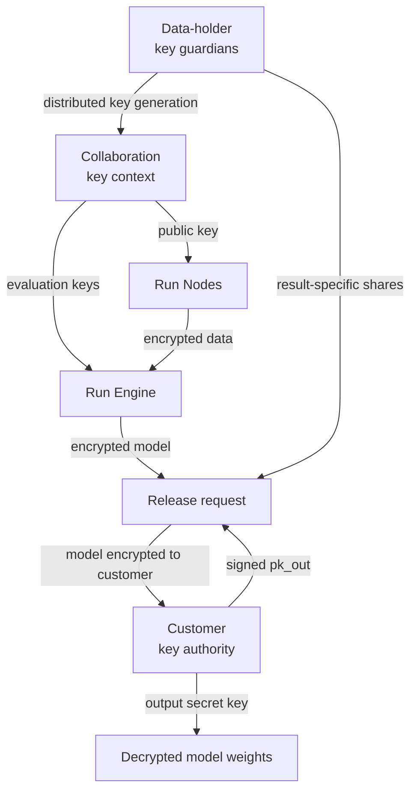

# Run key management and model release

## Decision summary

Run should not give the model/computation customer the FHE secret key used for
training data. If hospitals encrypt directly to a customer-owned FHE key, that
customer can decrypt any hospital ciphertext it later obtains, not only the
final model.

The target design uses two key domains:

1. Data-holder key guardians jointly control a **collaboration key** used for
   encrypted inputs, checkpoints, and training. No complete collaboration
   secret key exists in one place.
2. The customer controls a separate **output key**. After the exact encrypted
   model is approved, the guardians collectively release only that ciphertext
   to the output key.

The preferred release mechanism is per-ciphertext collective public-key
switching. A backend may instead use private threshold decryption in which each
guardian encrypts its partial decryption to the customer. Both approaches let
the customer recover the approved weights without receiving the collaboration
secret.

This is key provisioning, distributed key generation, and threshold result
release rather than a Diffie-Hellman-style exchange of one shared secret.

## Why the single-key design is insufficient

The reference image describes a normal FHE client/server flow:

```text
customer or consortium creates (public key, secret key, evaluation keys)
    -> hospitals encrypt with the public key
    -> Run Engine evaluates with evaluation keys
    -> customer decrypts final weights with the secret key
```

This is simple and matches the client/server model documented by
[Concrete](https://docs.zama.org/concrete/2.9/guides/deploy): the client creates
encryption/decryption and evaluation material, and the server receives only
evaluation keys and encrypted arguments.

Its limitation is fundamental: an FHE secret key is not scoped to an output
type or object. The customer can use it to decrypt raw-data ciphertexts,
encrypted checkpoints, intermediate values, and final weights created under
the same key. Storage ACLs can hide input ciphertexts from the customer, but
that is an operational control, not cryptographic separation.

Run may use this flow for an explicitly labelled research POC. It must not
claim that the data is cryptographically hidden from the customer.

## Target key topology



The customer has no collaboration-key share. Run's control and execution
planes have no secret-key material. Each guardian has only its own share.

## Key inventory

| Material | Holder | Purpose | Secret? |
|---|---|---|---|
| `pk_collab` | Run Nodes, Run Engine, control plane | Encrypt approved inputs under the collaboration context | No |
| `sk_collab_i` | One data-holder guardian or independent custodian | Participate in result-specific threshold release | Yes; never exported |
| `evk_collab` | Run Engine | Relinearization, rotations, bootstrapping, and other compiled FHE operations | Not a decryption key; still access-controlled |
| `pk_out` | Customer, guardians, control plane | Destination for the approved model release | No; signed by the customer |
| `sk_out` | Customer key authority | Recover the approved plaintext model | Yes; never sent to Run |
| `release_share_i` | Guardian, then release combiner | One guardian's contribution for one ciphertext and recipient | Ephemeral and result-specific |
| Identity signing keys | Every organization and service | Sign manifests, approvals, keys, ciphertext receipts, and release shares | Yes; separate from FHE keys |
| mTLS keys | Every service endpoint | Authenticate and encrypt network transport | Yes; separate from FHE keys |

FHE keys, identity-signing keys, and transport keys have different lifecycles
and must never be reused for one another.

## Protocol

### 1. Establish identities and the immutable collaboration

The control plane registers organization signing certificates, Run Node and
guardian identities, the customer identity, workload digest, compiler and FHE
parameters, output schema, allowed recipient, threshold, retention, and release
policy. Every party signs the resulting collaboration manifest.

### 2. Generate the collaboration key without a dealer

The guardians run a backend-supported distributed key-generation ceremony.
Each guardian creates `sk_collab_i` locally and keeps it in an HSM, protected
service, or offline host. The ceremony derives:

- `pk_collab`, signed by the participating guardians;
- only the evaluation keys required by the compiled circuit;
- a key-context digest binding scheme, parameters, guardian set, threshold,
  collaboration, program, and expiry.

The complete `sk_collab` must never be reconstructed, logged, backed up as one
object, or sent to Run. Nodes reject public or evaluation keys whose context
digest and guardian signatures do not match the approved manifest.

### 3. Register the customer output key

The customer generates `(pk_out, sk_out)` inside its own key authority and
signs `pk_out` together with the collaboration ID, job ID, permitted output
type, and expiry. Guardians verify this binding before release. This prevents a
control-plane operator from substituting its own recipient key.

`pk_out` may be an FHE public key for collective public-key switching or a
conventional recipient encryption key for private threshold decryption. The
selected backend defines the release protocol; it must not silently change
between the two.

### 4. Encrypt at each data holder

Each Run Node verifies the program and key-context digests, preprocesses and
validates data locally, encrypts tensors with `pk_collab`, and signs an envelope
containing the ciphertext digest, schema, batch, owner, collaboration, and
program IDs. The node uploads only ciphertext and approved metadata.

### 5. Train in Run Engine

Run Engine verifies every envelope and evaluates the frozen training circuit
with `evk_collab`. Inputs, model state, optimizer state, checkpoints, metrics,
and final weights remain under `pk_collab`. The worker emits a signed result
envelope and never receives `sk_collab_i` or `sk_out`.

### 6. Approve one exact result

Before producing a release share, every participating guardian verifies:

- collaboration, job, key-context, and unique release IDs;
- program, circuit, compiler, container, and run-manifest digests;
- input commitment root and required contributor set;
- final ciphertext digest, tensor names, shapes, quantization, and output type;
- customer identity and `pk_out` fingerprint;
- data-use purpose, expiry, retention, and approval quorum;
- execution evidence required by the collaboration's assurance tier.

Approval metadata alone does not prove that a ciphertext is the output of the
approved circuit. The initial product relies on isolated signed workers,
optional redundant execution, and audit evidence. High-assurance deployments
need a compatible verifiable-computation proof or an explicitly trusted
attested execution boundary before guardians release a share.

### 7. Release to the customer

Preferred flow:

1. Each guardian computes a public-key-switch share from its
   `sk_collab_i`, the exact `ct_weights`, and `pk_out`.
2. The guardian signs the share and its full release context.
3. An untrusted combiner validates signatures and aggregates the policy
   threshold of shares.
4. The combiner transforms `ct_weights` into `ct_weights_out`, decryptable only
   by `sk_out`.
5. The customer downloads and decrypts `ct_weights_out`, dequantizes the
   tensors, verifies the model manifest, and loads the weights into PyTorch or
   JAX.

Release shares must be ciphertext-specific. Run Engine must never receive a
generic collaboration-to-customer re-encryption key, because such a key could
allow it to re-key hospital input ciphertexts for the customer.

An alternative is private threshold decryption: guardians partially decrypt
the approved ciphertext and signcrypt each partial result to the customer. The
customer authenticates and combines enough partial results to recover the
weights. Zama's KMS documents this pattern as
[user decryption](https://github.com/zama-ai/kms/blob/main/docs/guides/entry_points.md#user-decryption).

### 8. Make release idempotent and auditable

A guardian generates at most one share for the tuple:

```text
(key_context_id, release_id, result_digest, pk_out_fingerprint)
```

It stores the encrypted share and returns the same bytes on retry. It never
regenerates fresh protocol material for the same request. This is especially
important because Lattigo's current
[security guidance](https://github.com/tuneinsight/lattigo/security#on-the-insecurity-of-retries)
warns that repeated multiparty protocol shares can enable key recovery. A
backend that cannot safely recover from an interrupted release must fail closed
and rotate to a new key context instead of improvising a retry.

After customer receipt, retention policy destroys release shares, expired
evaluation keys, ciphertexts, and temporary artifacts while preserving signed
audit receipts. Rotation creates a new key context; it does not overwrite the
meaning of prior artifacts.

## Choosing the threshold

The threshold is a security decision, not merely an availability setting.

- For a three-holder high-sensitivity pilot, `3-of-3` prevents any proper
  subset from releasing another holder's data but makes every holder required.
- `2-of-3` survives one unavailable guardian, but any two guardians can
  collaborate to release any ciphertext under the collaboration key.
- Larger deployments can distribute guardians across data holders and an
  independent trustee, but the accepted collusion set must be written into the
  contract and threat model.

The model customer should not hold a collaboration-key share. The customer's
role is represented by `pk_out`, so customer participation cannot reduce the
number of data holders needed to authorize release.

## Backend choices

The release protocol must use the same cryptographic scheme and parameters as
the training ciphertext. Threshold CKKS tooling cannot be bolted onto a
Concrete TFHE result, or vice versa.

| Path | Fit | Use in Run |
|---|---|---|
| [Concrete client/server deployment](https://docs.zama.org/concrete/2.9/guides/deploy) plus TFHE-rs public encryption | Matches the current training POC and developer experience | Single-key baseline only; customer access to input ciphertexts remains an operational trust assumption |
| [Zama threshold-fhe](https://github.com/zama-ai/threshold-fhe) and [Zama KMS](https://github.com/zama-ai/kms) | Threshold key generation/decryption in the TFHE family; KMS supports private release to a designated receiver | Preferred investigation for retaining the Concrete/TFHE direction, but Concrete artifact and ciphertext compatibility must be demonstrated rather than assumed |
| [Lattigo multiparty](https://pkg.go.dev/github.com/tuneinsight/lattigo/v6/multiparty) | Implements distributed keys and per-ciphertext collective public-key switching to an external receiver | Strong reference implementation for a CKKS/BGV Run Engine backend; cannot release Concrete TFHE ciphertexts |
| [OpenFHE threshold FHE](https://github.com/openfheorg/openfhe-development#examples) | Supports threshold BGV, BFV, and CKKS plus proxy re-encryption primitives | Alternative C++ backend; the exact result-specific release and retry behavior requires a dedicated security review |

Zama KMS's
[gRPC documentation](https://github.com/zama-ai/kms/blob/main/docs/guides/entry_points.md#grpc-interaction)
states that its direct core endpoints do not perform caller authorization. If
Run uses this path, every request must pass through Run's policy gateway, and
the core endpoints must remain private to the guardian environment.

## Recommended implementation sequence

### Phase A: image-compatible POC

- The customer key authority creates the Concrete client key and evaluation
  keys.
- Run Nodes encrypt with its public encryption material.
- Run Engine trains and returns encrypted weights.
- The customer decrypts and runs ordinary inference.
- Object-store ACLs prevent routine customer access to input ciphertexts.
- Documentation and tests state that this phase does **not** cryptographically
  protect inputs from the customer.

### Phase B: threshold release POC

- Run three guardian services and perform real distributed key generation.
- Have three Run Nodes encrypt under `pk_collab`.
- Execute a representative encrypted training or aggregation circuit under the
  same backend.
- Release only the final weight ciphertext to a separately generated customer
  key using `3-of-3` shares.
- Prove that `sk_out` decrypts the released weights and fails on input,
  checkpoint, and pre-release result ciphertexts.
- Test missing, duplicate, replayed, wrong-result, wrong-recipient, expired, and
  regenerated-share requests.

### Phase C: productization gate

- Integrate the threshold protocol with the actual autograd/optimizer backend,
  not a parallel demonstration scheme.
- Complete independent cryptographic review, parameter review, malicious-party
  testing, HSM integration, share backup/recovery design, and ceremony runbooks.
- Add result-provenance assurance appropriate to the customer tier.
- Block commercial multi-owner claims until Phase B and these controls pass.

## What the scheme guarantees—and what it does not

With fewer than the configured number of compromised guardians, the customer,
Run operator, and Run Engine cannot decrypt collaboration ciphertexts. After an
approved release, only the customer can recover the selected model output.

The scheme does not prevent:

- a threshold of guardians from colluding;
- a malicious data holder from contributing poisoned data;
- traffic, size, timing, and participation metadata leakage;
- denial of service by withholding a required share;
- leakage or memorization from the released plaintext model;
- an incorrect result being released when the provenance mechanism is trusted
  but compromised.

Output review, privacy testing, minimum-cohort rules, query budgets, model
extraction controls, and optional differential privacy remain separate product
requirements.
