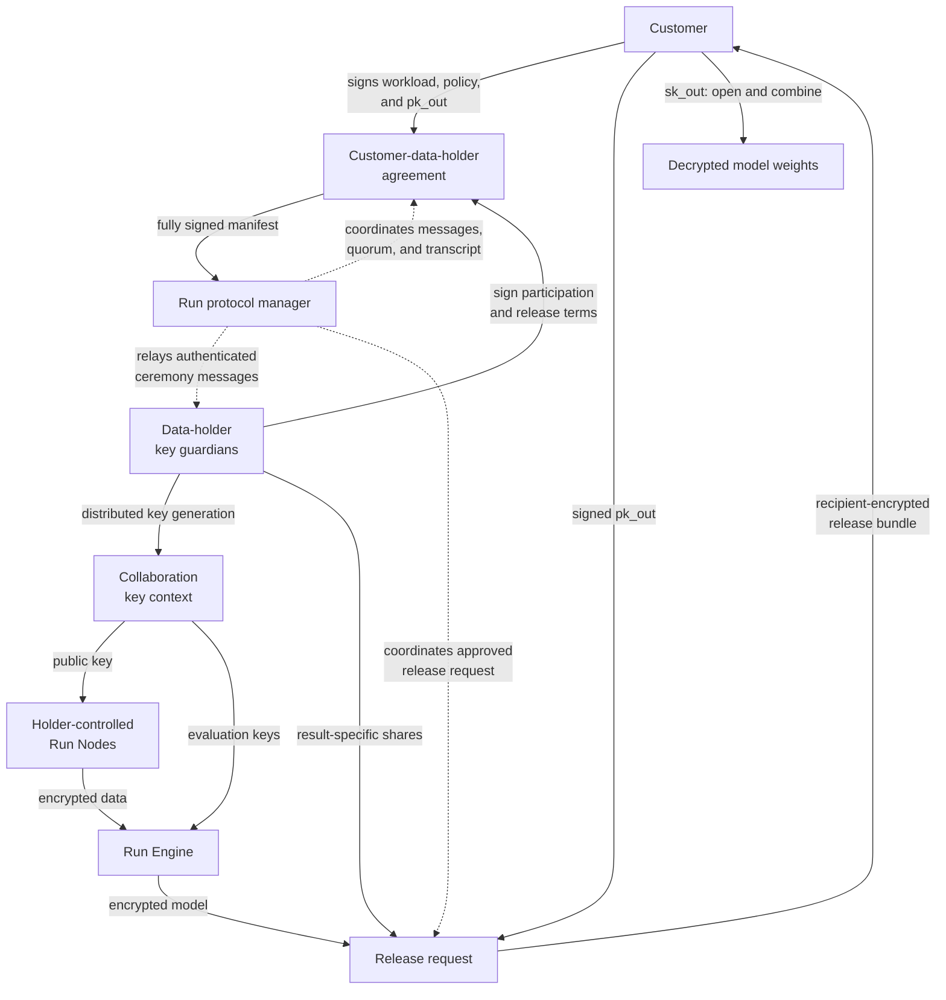

# Run key management and model release

## Decision summary

Run should not give the model/computation customer the FHE secret key used for
training data. If hospitals encrypt directly to a customer-owned FHE key, that
customer can decrypt any hospital ciphertext it later obtains, not only the
final model.

The target design uses two key domains:

1. Data-holder key guardians jointly control a **collaboration key** used for
   encrypted inputs, checkpoints, and training. No complete collaboration
   secret key exists in one place.
2. The customer controls a separate **output key**. After the exact encrypted
   model is approved, the guardians collectively release only that ciphertext
   to the output key.

Run manages the protocol lifecycle, but it is not a key owner or an approval
principal. The customer and every participating data holder directly sign the
collaboration agreement, including the workload, permitted inputs, recipient
key, release policy, and expiry. Run coordinates signatures, relays
authenticated distributed-key-generation and release messages, tracks the
state machine, and records the transcript. It contributes no key-generation
randomness, holds no secret share, and cannot authorize a release.

For the current Concrete/TFHE direction, the preferred production experiment
is maliciously secure threshold decryption with each partial result encrypted
to the customer. For an RLWE/CKKS or BGV backend, per-ciphertext collective
public-key switching is a strong alternative. Both approaches let the customer
recover the approved weights without receiving the collaboration secret.

This is key provisioning, distributed key generation, and threshold result
release rather than a Diffie-Hellman-style exchange of one shared secret.

## Why the single-key design is insufficient

The reference image describes a normal FHE client/server flow:

```text
customer or consortium creates (public key, secret key, evaluation keys)
    -> hospitals encrypt with the public key
    -> Run Engine evaluates with evaluation keys
    -> customer decrypts final weights with the secret key
```

This is simple and matches the client/server model documented by
[Concrete](https://docs.zama.org/concrete/2.9/guides/deploy): the client creates
encryption/decryption and evaluation material, and the server receives only
evaluation keys and encrypted arguments.

Its limitation is fundamental: an FHE secret key is not scoped to an output
type or object. The customer can use it to decrypt raw-data ciphertexts,
encrypted checkpoints, intermediate values, and final weights created under
the same key. Storage ACLs can hide input ciphertexts from the customer, but
that is an operational control, not cryptographic separation.

Run may use this flow for an explicitly labelled research POC. It must not
claim that the data is cryptographically hidden from the customer.

## Literature comparison

| Design | What it provides | Main limitation | Run decision |
|---|---|---|---|
| Single FHE key owned by the customer | Lowest integration cost and the standard Concrete client/server workflow | The customer can decrypt every ciphertext under that key if it obtains it | Training POC only |
| Multiparty/threshold FHE under one collective key | Constant-size ciphertexts, reusable setup, and decryption only with a qualifying set of guardians | Interactive setup and release; membership is normally fixed for a key context | Product default |
| Threshold FHE plus private recipient decryption | Guardians partially decrypt only the approved result and encrypt their shares to one recipient | Requires a maliciously secure, policy-gated threshold service | Preferred TFHE release |
| Threshold RLWE plus collective public-key switching | Converts one exact result from the collective key to an external recipient key without revealing plaintext | Noise-flooding, retry, and active-security requirements depend on the implementation | Preferred CKKS/BGV release |
| Multi-key FHE | Each holder keeps an unrelated key; dynamic variants can avoid a shared setup ceremony | Evaluation and ciphertext costs grow with participating keys, and practical TFHE constructions remain research-oriented | Research track only |

The RLWE multiparty construction of
[Mouchet et al.](https://eprint.iacr.org/2020/304) explicitly includes public
key switching to an external receiver. Their later
[threshold access-structure work](https://eprint.iacr.org/2022/780) extends the
collective-key model from all-party release to qualifying subsets. This matches
Run's static consortium use case: owners encrypt under one collective public
key, Run Engine evaluates, and guardians participate only in setup and output.

For the TFHE path, [Zama KMS](https://github.com/zama-ai/kms) is a closer match
than an RLWE public-key switch. It provides TFHE-rs-compatible threshold key
generation and threshold decryption and describes a private user-decryption
flow in which partial decryptions are signcrypted to a designated receiver. Its
stated goal includes robustness and security against malicious parties.

Multi-key TFHE removes the shared-key ceremony and can support changing
participants. However, the practical construction of
[Akın, Klemsa, and Önen](https://eprint.iacr.org/2023/065) has evaluation cost
linear in the number of participating parties and proves security in the
semi-honest model, with malicious-party countermeasures left informal. That is
useful research, but weaker than Run's production threat model.

This comparison changes the design in three ways:

1. TFHE uses private threshold decryption to the customer as the primary path;
   public-key switching is backend-specific rather than universal.
2. Production requires malicious security, robustness, and authenticated
   transcripts, not only threshold arithmetic.
3. Dynamic membership creates a new key context and re-encryption campaign;
   multi-key FHE remains a later optimization rather than the initial design.

## Target key topology



The customer has no collaboration-key share. Run's control and execution
planes have no secret-key material. Each guardian has only its own share. Run
operates the protocol manager and may relay public material, but it is not a
party to the cryptographic agreement between the customer and data holders.

## Key inventory

| Material | Holder | Purpose | Secret? |
|---|---|---|---|
| `pk_collab` | Data holders and holder-controlled Run Nodes | Encrypt approved inputs under the collaboration context | No; public by construction |
| `sk_collab_i` | One data-holder guardian or independent custodian | Participate in result-specific threshold release | Yes; never exported |
| `evk_collab` | Run Engine | Relinearization, rotations, bootstrapping, and other compiled FHE operations | Not a decryption key; still access-controlled |
| `pk_out` | Customer and data-holder guardians; relayed by Run | Recipient key for signcrypted decryption shares or a switched FHE result | No; signed by the customer |
| `sk_out` | Customer key authority | Open the approved release bundle and recover the model | Yes; never sent to Run |
| `release_share_i` | Guardian, then release coordinator | One guardian's contribution for one ciphertext and recipient | Ephemeral and result-specific |
| Common reference string | Guardians, nodes, engine | Distributed setup and, where supported, ciphertext-validity proofs | No; ceremony transcript is audited |
| Identity signing keys | Every organization and service | Sign manifests, approvals, keys, ciphertext receipts, and release shares | Yes; separate from FHE keys |
| mTLS keys | Every service endpoint | Authenticate and encrypt network transport | Yes; separate from FHE keys |

FHE keys, identity-signing keys, and transport keys have different lifecycles
and must never be reused for one another.

## Protocol

### 1. Establish the customer-data-holder agreement

Run's control plane creates and manages the signing workflow for an immutable
collaboration manifest. It registers organization signing certificates, Run
Node and guardian identities, the customer identity, workload digest, compiler
and FHE parameters, output schema, allowed recipient, threshold, retention, and
release policy.

The customer proposes and signs the workload, purpose, recipient-key binding,
and commercial terms. Every participating data holder independently signs its
participation, permitted data use, and release conditions. The agreement is
effective only after the required customer and data-holder signatures are
present. Run verifies and records those signatures and may sign an operational
receipt, but its signature cannot replace either side's consent or satisfy the
release quorum.

### 2. Generate the collaboration key without a dealer

Run starts and manages a backend-supported, maliciously secure distributed
key-generation ceremony after the agreement is fully signed. It assigns
ceremony and round identifiers, relays authenticated messages, enforces the
participant set and deadlines, and records the signed transcript. Each
data-holder guardian creates `sk_collab_i` locally and keeps it in an HSM,
protected service, or offline host. Run contributes no dealer secret,
randomness, or key share. The ceremony must detect or exclude malformed
contributions. It derives:

- `pk_collab`, signed by the participating guardians;
- only the evaluation keys required by the compiled circuit;
- a key-context digest binding scheme, parameters, guardian set, threshold,
  collaboration, program, and expiry.

The complete `sk_collab` must never be reconstructed, logged, backed up as one
object, or sent to Run. Nodes reject public or evaluation keys whose context
digest and guardian signatures do not match the approved manifest.

Multiparty HE setup can be reused for many evaluations. Run therefore defaults
to one key context per fixed-membership collaboration and rotates it on member,
parameter, or trust-policy changes. A per-job key reduces blast radius but pays
the full distributed setup cost for every run.

### 3. Register the customer's recipient key

The customer generates `(pk_out, sk_out)` inside its own key authority and
signs `pk_out` together with the collaboration ID, job ID, permitted output
type, and expiry. Run relays this signed binding and records its digest; every
guardian verifies it directly against the customer identity named in the
agreement. This prevents a control-plane operator from substituting its own
recipient key.

For TFHE private threshold decryption, `pk_out` is the customer's recipient
encryption/signcryption key. For collective public-key switching, it is an FHE
public key under compatible parameters. The selected backend defines the key
type and release protocol; it must not silently change between the two.

### 4. Encrypt at each data holder

Each Run Node verifies the program and key-context digests, preprocesses and
validates data locally, encrypts tensors with `pk_collab`, and signs an envelope
containing the ciphertext digest, schema, batch, owner, collaboration, and
program IDs. The node uploads only ciphertext and approved metadata.

The node's encryption function and data-holder signing key remain under the
data holder's administrative control; Run cannot remotely originate a valid
contribution. Because `pk_collab` is a public key, possession of it cannot
cryptographically stop Run or anyone else from forming a ciphertext. The
actual security boundary is provenance: Run Engine accepts a ciphertext only
when its envelope is signed by an allowed data holder for the frozen manifest.
As a least-privilege control, guardians deliver `pk_collab` directly to the
holder-controlled Nodes; Run stores its fingerprint and is not provisioned
with an encryption endpoint. This narrows exposure, while the holder signature
remains the security control that prevents forged contributions.

Nodes use authenticated private transport and backend-supported ciphertext
validity or plaintext-knowledge proofs where available. The control plane and
engine reject malformed encodings, wrong parameters, unknown key contexts, and
replayed envelopes before evaluation.

### 5. Train in Run Engine

Run Engine verifies every envelope and evaluates the frozen training circuit
with `evk_collab`. Inputs, model state, optimizer state, checkpoints, metrics,
and final weights remain under `pk_collab`. The worker emits a signed result
envelope and never receives `sk_collab_i` or `sk_out`.

### 6. Approve one exact result

Before producing a release share, every participating guardian verifies:

- collaboration, job, key-context, and unique release IDs;
- program, circuit, compiler, container, and run-manifest digests;
- input commitment root and required contributor set;
- final ciphertext digest, tensor names, shapes, quantization, and output type;
- customer identity and `pk_out` fingerprint;
- data-use purpose, expiry, retention, and approval quorum;
- execution evidence required by the collaboration's assurance tier.

Approval metadata alone does not prove that a ciphertext is the output of the
approved circuit. The initial product relies on isolated signed workers,
optional redundant execution, and audit evidence. High-assurance deployments
need a compatible verifiable-computation proof or an explicitly trusted
attested execution boundary before guardians release a share.

The release API is not a general decryption oracle. It accepts only registered
result handles, returns no plaintext or fine-grained decryption errors to Run,
and is reachable only through the policy gateway. Each guardian independently
recomputes the release decision from the signed manifest.

### 7A. Preferred TFHE release: private threshold decryption

This follows the recipient-private
[Zama KMS user-decryption pattern](https://github.com/zama-ai/kms/blob/main/docs/guides/entry_points.md#user-decryption):

1. Each guardian partially decrypts the exact `ct_weights` with
   `sk_collab_i`.
2. It signcrypts that partial result and its full release context to `pk_out`.
3. The release coordinator validates outer signatures and forwards an opaque
   bundle. It cannot open the partial results.
4. The customer uses `sk_out` to authenticate and open enough partial results,
   combines them into the plaintext weights, dequantizes the tensors, verifies
   the model manifest, and loads the model into PyTorch or JAX.

No guardian learns the final plaintext, and the customer never receives an FHE
secret-key share. The protocol and implementation must be robust against
malformed or missing guardian contributions, not merely correct when every
party follows the protocol.

### 7B. CKKS/BGV alternative: collective public-key switching

For a compatible RLWE backend:

1. Each guardian computes a public-key-switch share from its
   `sk_collab_i`, the exact `ct_weights`, and FHE recipient key `pk_out`.
2. The guardian signs the share and its full release context.
3. An untrusted combiner validates signatures and aggregates the policy
   threshold of shares.
4. The combiner transforms `ct_weights` into `ct_weights_out`, decryptable only
   by `sk_out`.
5. The customer decrypts and validates `ct_weights_out` locally.

Release shares must be ciphertext-specific. Run Engine must never receive a
generic collaboration-to-customer re-encryption key, because such a key could
allow it to re-key hospital input ciphertexts for the customer.

### 8. Make release idempotent and auditable

A guardian generates at most one share for the tuple:

```text
(key_context_id, release_id, result_digest, pk_out_fingerprint)
```

It stores the encrypted share and returns the same bytes on retry. It never
regenerates fresh protocol material for the same request. This is especially
important because Lattigo's current
[security guidance](https://github.com/tuneinsight/lattigo/security#on-the-insecurity-of-retries)
warns that repeated multiparty protocol shares can enable key recovery. A
backend that cannot safely recover from an interrupted release must fail closed
and rotate to a new key context instead of improvising a retry.

After customer receipt, retention policy destroys release shares, expired
evaluation keys, ciphertexts, and temporary artifacts while preserving signed
audit receipts. Rotation creates a new key context; it does not overwrite the
meaning of prior artifacts.

## Security conditions from the literature

### Active security and robustness

A threshold count alone does not imply security against malicious parties.
Production must use a protocol whose proof and implementation cover malicious
guardians, malformed shares, aborts, equivocation, and the chosen corruption
threshold. Every ceremony and release message is authenticated and transcript
bound. A semi-honest multiparty implementation is acceptable only for a
labelled experiment. Robust threshold constructions have protocol-specific
corruption bounds; for example, the
[Zama threshold specification](https://eprint.iacr.org/2025/699) gives different
bounds for different malicious-security settings. Run must adopt the bound of
the exact protocol it deploys.

### Decryption noise and query bounds

Approximate schemes require particular care when any decryption information is
shared. Li-Micciancio-style attacks recover CKKS secret material from
decryption outputs, and subsequent
[USENIX Security 2024 results](https://www.usenix.org/conference/usenixsecurity24/presentation/guo-qian)
show that non-worst-case noise-flooding estimates can remain vulnerable. A
CKKS release backend must use a reviewed worst-case bound, explicit statistical
security, and a hard bound on adversarial release queries. Empirical or
average-case noise estimates are not a production default.

Exact schemes and TFHE still require the countermeasures specified by their
threshold protocol; Run does not infer safety merely because the plaintext is
integer-valued. Backend-specific decryption failure probabilities and release
limits are part of the signed key context.

### Parameter selection

Each key context records scheme, ring/LWE dimensions, modulus chain, error and
secret distributions, failure probability, circuit depth, packing, threshold,
and security estimate. Parameters must meet the current
[Homomorphic Encryption Standard](https://homomorphicencryption.org/wp-content/uploads/2024/08/Homomorphic-Encryption-Standard-v1.1.pdf)
or a stricter backend-reviewed profile. Compiler convenience must not silently
override the security profile.

### Output privacy remains separate

Threshold release limits who can decrypt; it does not limit what an approved
model reveals. Membership inference, memorization, inversion, repeated model
releases, and differencing require a separate output-risk review, release
budget, access control, and—where the utility tradeoff permits—differential
privacy.

## Choosing the threshold

The threshold is a security decision, not merely an availability setting.

- For a three-holder high-sensitivity pilot, `3-of-3` prevents any proper
  subset from releasing another holder's data but makes every holder required.
- `2-of-3` survives one unavailable guardian, but any two guardians can
  collaborate to release any ciphertext under the collaboration key.
- Larger deployments can distribute guardians across data holders and an
  independent trustee, but the accepted collusion set must be written into the
  contract and threat model.

The model customer should not hold a collaboration-key share. The customer's
role is represented by `pk_out`, so customer participation cannot reduce the
number of data holders needed to authorize release.

Production does not choose an arbitrary fraction such as `2/3` and then assume
the protocol supports it. The guardian count, reconstruction threshold,
maximum malicious or unavailable parties, and liveness assumptions must match
the exact proven configuration of the selected implementation. `3-of-3` is a
useful confidentiality POC but deliberately has no offline-party tolerance.

## Backend choices

The release protocol must use the same cryptographic scheme and parameters as
the training ciphertext. Threshold CKKS tooling cannot be bolted onto a
Concrete TFHE result, or vice versa.

| Path | Fit | Use in Run |
|---|---|---|
| [Concrete client/server deployment](https://docs.zama.org/concrete/2.9/guides/deploy) plus TFHE-rs public encryption | Matches the current training POC and developer experience | Single-key baseline only; customer access to input ciphertexts remains an operational trust assumption |
| [Zama KMS](https://github.com/zama-ai/kms) | Maliciously secure and robust threshold key generation/decryption with TFHE-rs-compatible keys and private recipient release | Primary production investigation for the Concrete/TFHE direction; Concrete artifact and ciphertext compatibility must be proven |
| [Zama threshold-fhe](https://github.com/zama-ai/threshold-fhe) | Research snapshot for threshold TFHE, BFV, and BGV | Literature and benchmark reference only; its README redirects maintained use to Zama KMS |
| [Lattigo multiparty](https://pkg.go.dev/github.com/tuneinsight/lattigo/v6/multiparty) | Implements distributed keys and per-ciphertext collective public-key switching to an external receiver | Strong CKKS/BGV reference; retry and active-security properties require review, and it cannot release Concrete TFHE ciphertexts |
| [OpenFHE threshold FHE](https://github.com/openfheorg/openfhe-development#examples) | Supports threshold BGV, BFV, and CKKS plus proxy re-encryption primitives | Alternative C++ backend; secure noise mode, result-specific release, query bounds, and malicious behavior require dedicated review |
| [Practical multi-key TFHE](https://eprint.iacr.org/2023/065) | Independent owner keys and dynamic-party variants | Research track; linear per-party evaluation cost and semi-honest proof do not meet the initial production threat model |

Zama KMS's
[gRPC documentation](https://github.com/zama-ai/kms/blob/main/docs/guides/entry_points.md#grpc-interaction)
states that its direct core endpoints do not perform caller authorization. If
Run uses this path, every request must pass through Run's policy gateway, and
the core endpoints must remain private to the guardian environment.

## Recommended implementation sequence

### Phase A: image-compatible POC

- The customer key authority creates the Concrete client key and evaluation
  keys.
- Run Nodes encrypt with its public encryption material.
- Run Engine trains and returns encrypted weights.
- The customer decrypts and runs ordinary inference.
- Object-store ACLs prevent routine customer access to input ciphertexts.
- Documentation and tests state that this phase does **not** cryptographically
  protect inputs from the customer.

### Phase B: threshold release POC

- Run manages the ceremony state machine and opaque message relay across three
  data-holder-controlled guardian services; it owns no share.
- The customer and all data holders sign the manifest and recipient-key
  binding before key generation or data contribution begins.
- Have three Run Nodes encrypt under `pk_collab`.
- Execute a representative encrypted training or aggregation circuit under the
  same backend.
- Use `3-of-3` private threshold decryption for the TFHE experiment and
  signcrypt each partial result to a separately generated customer key.
- Prove that `sk_out` opens only the approved release bundle; it is not an FHE
  key and cannot decrypt input, checkpoint, or pre-release ciphertexts.
- Prove that no guardian or release coordinator learns the final weights.
- Prove that Run cannot satisfy a holder signature, the release quorum, or the
  customer-data-holder agreement by itself.
- Test missing, duplicate, replayed, wrong-result, wrong-recipient, expired, and
  regenerated-share requests, plus malformed and equivocating guardian shares.

### Phase C: productization gate

- Integrate the threshold protocol with the actual autograd/optimizer backend,
  not a parallel demonstration scheme.
- Complete independent cryptographic review, parameter review, malicious-party
  testing, HSM integration, share backup/recovery design, and ceremony runbooks.
- Validate the chosen corruption threshold and liveness guarantees against the
  implementation's proof and deployed guardian count.
- Add result-provenance assurance appropriate to the customer tier.
- Block commercial multi-owner claims until Phase B and these controls pass.

## What the scheme guarantees—and what it does not

Under the selected protocol's stated corruption and robustness assumptions,
and with fewer than the configured number of compromised guardians, the
customer, Run operator, and Run Engine cannot decrypt collaboration
ciphertexts. After an approved release, only the customer can recover the
selected model output.

The scheme does not prevent:

- a threshold of guardians from colluding;
- a malicious data holder from contributing poisoned data;
- traffic, size, timing, and participation metadata leakage;
- denial of service by withholding a required share;
- leakage or memorization from the released plaintext model;
- an incorrect result being released when the provenance mechanism is trusted
  but compromised.

Output review, privacy testing, minimum-cohort rules, query budgets, model
extraction controls, and optional differential privacy remain separate product
requirements.
