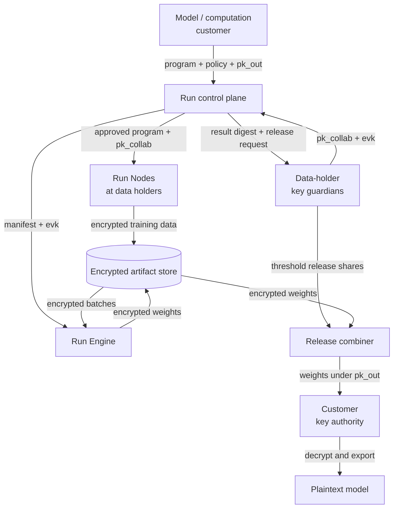

# Run product architecture

## Executive summary

**Run** is an FHE-native platform for computing across sensitive datasets that
cannot be pooled in plaintext. A workload author specifies a data contract and
a computation. Each data owner maps local data into that contract, reviews the
exact workload and release policy, encrypts the resulting tensors locally, and
sends only ciphertext to a remote execution service. The result remains
encrypted until the authorized recipient decrypts it inside a customer-owned
trust boundary.

The public product family has four parts:

1. **Run** is the complete collaboration and encrypted-compute platform.
2. **Run Engine** is the FHE compiler and runtime.
3. **Run Exchange** is the governed data-access marketplace.
4. **Run Nodes** are customer-hosted data-plane agents.

The OSS repository, Python package, and CLI retain the technical name `nftpz`.

The product separates orchestration from computation:

1. **Run Nodes** connect to private data, preprocess it, and encrypt it.
2. **The SaaS control plane** coordinates identities, contracts, policies,
   approvals, jobs, metering, and audit metadata.
3. **Run Engine** compiles and runs approved circuits over ciphertext in a
   public cloud or customer VPC.
4. **Data-holder key guardians** hold shares of the collaboration secret and
   authorize release of an exact encrypted result.
5. **The customer key authority** holds a separate output secret key and
   decrypts only results released to that key.

The long-term product supports broad computation and general ML/AI training.
Every release must publish a capability matrix that distinguishes certified,
preview, and research workloads. The platform must never silently move an
unsupported operation into plaintext.

## Product principles

- Plaintext stays in the data owner's environment.
- The control plane does not execute sensitive computations.
- The execution plane never receives an FHE secret key.
- Every run binds exact code, schemas, contributors, keys, policies, and output
  rights into an immutable manifest.
- Every contributing organization approves the exact workload and result
  policy before its data is used.
- FHE protects computation, not the safety of a released result. Models,
  aggregates, embeddings, and repeated queries remain disclosure surfaces.
- A program that cannot meet its declared security, correctness, and cost
  constraints fails before data upload.
- The developer experience should feel like constrained Python and PyTorch,
  while exposing enough information to make FHE cost and precision predictable.

## System context



Ciphertext objects move directly between Run Nodes, execution storage, and
workers. The control plane receives object references, hashes, sizes, statuses,
and policy metadata, not payload bytes.

### Translation of the reference image

| Reference-image term | Run architecture term | Security interpretation |
|---|---|---|
| Hospitals | Data holders operating Run Nodes | Plaintext and preprocessing stay inside each holder; the node encrypts approved tensors with the collaboration public key. |
| Public encryption key | Collaboration public key, `pk_collab` | Anyone authorized to contribute can encrypt, but cannot decrypt. |
| `nftpz` worker | Run Engine worker | Receives ciphertext and evaluation keys, runs encrypted training, and cannot decrypt inputs, state, or weights. |
| Encrypted final weights | Result ciphertext, `ct_weights` | Initially remains under `pk_collab`; it is not yet decryptable by the customer. |
| Customer/consortium key authority | Data-holder key guardians plus the customer key authority | Split into two roles so the customer never receives the collaboration secret. |
| Model buyer | Model or computation customer | Holds only the output secret key and decrypts weights after threshold-approved release. |

The image's simpler design uses one FHE key pair: hospitals encrypt with its
public key and the customer or consortium holds its secret key. That flow is
compatible with a conventional client/server FHE deployment, but possession of
the secret key permits decryption of *every* ciphertext under that key,
including captured hospital inputs. It is therefore a useful POC mode, not the
target trust model when data holders require cryptographic protection from the
customer.

## Roles and trust boundaries

| Role | Responsibilities | Must not access |
|---|---|---|
| Workload author | Defines the input contract, computation, expected output, and acceptance tests | Owner source systems and unapproved outputs |
| Data steward | Maps local sources, reviews requested fields, validates rights and consent, approves participation | Other owners' records or keys |
| Collaboration administrator | Invites organizations, configures roles, freezes run membership, and manages budgets | Plaintext owner data |
| Security/privacy reviewer | Reviews code digest, data-use purpose, output policy, security profile, and retention | Data outside the approved local review path |
| Model/computation customer | Supplies the signed workload and output public key and receives the approved result | Raw contributor data, collaboration-key shares, and intermediate state |
| Data-holder key guardian | Participates in distributed key generation, protects one secret share, and issues a release share for an approved result | The complete collaboration secret and other holders' plaintext |
| Customer key authority | Protects the output secret key and decrypts the result after release | The collaboration secret, training ciphertext plaintexts, and unapproved outputs |
| Platform operator | Operates control and execution services | Secret keys, plaintext inputs, intermediates, and results |
| Auditor | Reads immutable manifests, approvals, receipts, and security evidence | Plaintext unless separately authorized |

The execution service is assumed to be honest-but-curious for confidentiality
and potentially faulty or malicious for availability and integrity. FHE hides
plaintext from it, but FHE alone does not prove that it ran the intended program
or included every input. Signed manifests, deterministic simulation, input
commitments, restricted workers, and optional redundant execution address this
operationally. Verifiable execution is a later cryptographic workstream.

## Planes and services

### Run Nodes (owner data plane)

A Run Node is installed on a VM, bare-metal host, or Kubernetes
cluster controlled by each contributing organization. It uses outbound-only
mTLS to communicate with the control plane and encrypted storage.

Core components:

- **Connector runtime:** Parquet, CSV, S3-compatible storage, PostgreSQL, and
  initial FHIR/tabular healthcare connectors. DICOM, omics stores, warehouses,
  and additional enterprise systems are plugins.
- **Local transform runner:** executes owner-authored preprocessing in a
  rootless, resource-limited container with an explicit source allowlist and
  no outbound network by default.
- **Contract validator:** enforces types, shapes, units, bounds, missingness,
  consent, purpose, and policy tags before encryption.
- **FHE client:** quantizes, batches, pads, encrypts, serializes, and signs data
  using collaboration-scoped public parameters.
- **Upload manager:** performs resumable multipart uploads with checksums and
  idempotency tokens.
- **Local evidence store:** records source versions, transform digest, rejected
  rows, validation summaries, and upload receipts without exposing values to
  the vendor.

The Run Node never downloads and runs mutable code from the control plane. It
runs only a content-addressed transform bundle that the owner has installed or
explicitly approved.

### SaaS control plane

The managed control plane contains:

- **Identity and organization service:** OIDC/SAML, SCIM, RBAC, service
  identities, and organization boundaries.
- **Collaboration service:** membership, purpose, contracts, regional settings,
  budgets, and lifecycle.
- **Schema and metadata catalog:** dataset contracts, fields, units,
  modalities, consent and use restrictions, quality summaries, and lineage.
- **Workload registry:** immutable program bundles, compiler reports,
  signatures, capability tier, and version history.
- **Policy and approval service:** contributor approvals, release quorum,
  minimum-site requirements, output restrictions, expiry, and revocation.
- **Compiler coordinator:** schedules managed compilation or verifies locally
  compiled artifacts.
- **Job orchestrator:** freezes manifests, issues scoped credentials, schedules
  workers, tracks checkpoints, and handles retries.
- **Audit ledger:** append-only signed events suitable for customer export to a
  SIEM or archive.
- **Metering and billing:** collaboration subscription, data-access rights,
  compilation, worker use, storage, and transfer.

Control-plane databases hold metadata only. Sensitive metadata is minimized,
pseudonymous identifiers are preferred, and customer-visible audit events must
show what the platform operator could observe.

### Run Engine execution plane

Execution planes are regional and can run in the vendor account, a dedicated
customer VPC, or a sovereign/self-hosted environment. Each collaboration gets
isolated storage prefixes, queues, cryptographic contexts, caches, workload
identities, and network policy.

Core components:

- **Worker scheduler:** selects CPU, GPU, memory, and locality profiles from the
  signed execution plan.
- **Circuit cache:** content-addressed compiled artifacts keyed by program,
  backend, security profile, and hardware target.
- **Evaluation-key cache:** encrypted-at-rest, collaboration-scoped, revocable,
  and never reused across incompatible contexts.
- **Execution workers:** default-deny egress, read-only program image, ephemeral
  scratch space, and no interactive shell in production.
- **Checkpoint service:** stores only encrypted parameters, optimizer state,
  partial aggregates, and signed step metadata.
- **Result packager:** emits the encrypted result, provenance, worker receipts,
  cost data, and all hashes required for release verification.

Jobs are batch-oriented. A retry resumes from the last committed encrypted
checkpoint and cannot apply a batch twice. A worker must reject mismatched
program, key, schema, batch, or context identifiers.

### Key guardians, release combiner, and customer key authority

Each data holder operates a key guardian beside its Run Node or delegates that
role to an independently governed custodian. Guardians use distributed key
generation; no complete collaboration secret is ever constructed. Each share
is non-exportable where the backend and HSM integration permit it.

The customer key authority runs in the result owner's environment. It creates
a separate output key pair, publishes only `pk_out`, and keeps `sk_out` in an
HSM, KMS, or offline key host. It never receives a collaboration-key share.

For an approved result, a policy threshold of guardians produces shares for a
collective public-key switch of the exact `ct_weights` to `pk_out`. The release
combiner can be untrusted: it aggregates shares into `ct_weights_out`, but it
does not learn plaintext or either secret key. The customer decrypts
`ct_weights_out`, dequantizes the parameters, and loads an ordinary model.

Every guardian verifies the collaboration, run manifest, program and circuit
digests, input commitment root, result ciphertext digest, output schema,
recipient-key fingerprint, approval quorum, expiry, and unique release ID
before producing a share. It persists and replays the same signed share for an
idempotent retry instead of generating another share.

The full protocol, threat model, POC fallback, and backend options are specified
in [`key-exchange.md`](key-exchange.md).

## Versioned artifacts and contracts

All public schemas use versioned JSON Schema/Pydantic models and stable content
digests.

### `DatasetContract`

Defines logical fields, encoded dtypes, tensor shapes, units, allowed ranges,
privacy tags, permitted missingness, batching, padding, and contribution
minimums. Compilation uses synthetic or public representative data plus these
declared bounds. Private calibration samples do not leave an owner.

### `TransformBundle`

Contains an owner-specific preprocessing image digest, entry point, connector
permissions, output contract, and reproducibility metadata. The source may
remain private to the owner; the collaboration records the executable digest.

### `ProgramBundle`

Contains the typed FHE graph, source digest, compiler/backend versions,
operator report, clear and simulated tests, numerical-error report, and output
schema. Proprietary workload authors may compile locally and upload only this
signed artifact.

### `ExecutionPlan`

Binds the program and data contract to a backend, security profile, hardware
target, static dimensions, parameter ranges, key specification, estimated
runtime, memory, ciphertext size, and cost envelope.

### `ReleasePolicy`

Names permitted recipients, required approvers, minimum contributors, output
types, result-size limits, query/release budget, retention, expiry, and any
suppression, rounding, or differential-privacy requirement.

### `RunManifest` and `ResultEnvelope`

The run manifest freezes exact contributors, batch commitments, artifact
digests, key ID, compiler parameters, and dependency versions. The result
envelope contains encrypted outputs, checkpoints or final model state,
provenance, measured cost, and signed execution receipts.

Changing code, schema, contributors, outputs, keys, parameters, or policy
creates a new version and invalidates prior approvals.

## Run Engine: FHE compiler and runtime

### Typed intermediate representation

Programs lower into an FHE IR with:

- static tensor shapes and bounded loops;
- explicit signedness, bit width, scale, and numeric range;
- encrypted, public, and locally held values;
- privacy and provenance labels;
- deterministic operations without network, filesystem, reflection, or dynamic
  code loading;
- placement labels for local preprocessing, remote FHE, and local
  post-processing.

The compiler must return actionable source-linked diagnostics for unsupported
operators, unsafe ranges, overflow, excessive programmable bootstrapping,
incompatible hardware, and estimated cost beyond the author's budget.

### Backend interface

The internal `FHEBackend` contract supports:

```text
analyze(graph, contract, target) -> CompatibilityReport
simulate(graph, fixtures) -> SimulationResult
estimate(graph, contract, target) -> CostEstimate
compile(graph, contract, target) -> ProgramBundle
client_spec(program) -> ClientSpecification
encrypt(client_spec, batch) -> CiphertextBatch
execute(program, evaluation_keys, ciphertexts) -> CiphertextResult
release(result, output_public_key, threshold_shares) -> CiphertextResult
decrypt(client_spec, output_secret_key, released_result) -> PlainResult
```

Concrete and Concrete ML are the first backend for exact integer arithmetic,
lookup tables, quantized ML, small encrypted training, and hybrid model
partitioning. The commercial product must secure the required Zama patent
license. A compatible threshold-TFHE path is a productization gate. OpenFHE is
evaluated for CKKS approximate arithmetic, alternate packing, and threshold
BFV/BGV/CKKS.

### Workload capability tiers

**Certified:**

- bounded integer and quantized arithmetic;
- sum, count, mean, comparison, filter masks, histograms, and fixed-shape
  tabular computations;
- linear and logistic regression training and inference;
- small fixed-shape quantized MLPs with supported activations, losses, and
  SGD-family optimizers;
- multi-owner batch concatenation under one collaboration key.

**Preview:**

- restricted NumPy-style programs;
- generated PyTorch autograd and functional optimizers;
- GPU and multi-GPU execution;
- hybrid neural-network inference and LoRA fine-tuning;
- output suppression, minimum-cohort rules, and optional DP post-processing.

**Research:**

- full encrypted training of large neural networks;
- shared multi-owner LoRA state without exposing adapters to sites;
- arbitrary optimizer graphs and transformer pretraining;
- private cross-owner entity resolution;
- cryptographic threshold release and verifiable FHE execution.

Arbitrary Python, arbitrary containers, unbounded data-dependent control flow,
and full frontier-model pretraining are not launch capabilities.

## Hybrid ML and AI execution

The graph partitioner uses three placements:

- `LOCAL_CLEAR`: owner-side preprocessing, unsupported layers, loss, or local
  adapter updates.
- `REMOTE_FHE`: encrypted linear algebra and supported nonlinear kernels.
- `LOCAL_POSTPROCESS`: approved dequantization, formatting, and export.

Current Concrete ML hybrid approaches can outsource expensive linear layers
while keeping nonlinear layers or LoRA state client-side. This makes large
model adaptation a viable product direction, but it is interactive and does
not by itself create one pooled multi-owner model. Hybrid LoRA is therefore
certified first for a single owner or independent per-owner fine-tunes.
Multi-owner shared adaptation remains research until shared state and optimizer
updates stay encrypted or use a separately reviewed aggregation protocol.

## Two-sided developer experience

### Workload author

```python
from nftpz import DatasetContract, FHETrainer, fhe


class PatientFeatures(DatasetContract):
    x: Tensor["batch", 64, "int8"]
    y: Tensor["batch", 1, "int8"]


@fhe.program(inputs=[PatientFeatures], output="encrypted_model")
def train(batch):
    return FHETrainer(
        model=RiskModel(),
        loss="mse",
        optimizer={"name": "sgd", "lr": 0.125},
    ).fit(batch.x, batch.y)
```

The SDK produces clear tests, quantized simulation, unsupported-operation
diagnostics, overflow and precision analysis, CPU/GPU compatibility, key and
ciphertext sizes, runtime and cost estimates, and an immutable review bundle.

### Data owner and Run Node

```python
from nftpz import fhe


@fhe.local_transform(output=PatientFeatures)
def prepare(source: FHIRConnection) -> PatientFeatures:
    ...
```

Before approval, the owner sees requested fields, local source, transformed
row count, rejected or clipped values, bounds, batch sizes, workload digest,
human-readable computation summary, participants, result recipient, output
rights, retention, estimated upload, and release policy.

### CLI

The `nftpz` command remains the technical CLI namespace for the Run platform.

```text
nftpz init
nftpz doctor
nftpz test --clear
nftpz simulate
nftpz estimate
nftpz publish
nftpz collaboration invite
nftpz node install
nftpz dataset validate
nftpz dataset approve
nftpz run start
nftpz run status
nftpz result approve
nftpz result decrypt
```

The portal exposes the same lifecycle for collaboration administrators, data
stewards, reviewers, result recipients, and auditors.

## End-to-end workflow

1. The workload author publishes a dataset contract, computation, tests, and
   release policy.
2. Clear execution, FHE simulation, compatibility analysis, and cost estimation
   must pass.
3. Compilation emits an immutable program and execution plan.
4. Each data owner reviews and approves the exact digest and implements its
   local mapping.
5. Data-holder key guardians run distributed key generation and publish
   `pk_collab` and the required evaluation keys.
6. The customer registers a signed, collaboration-bound output public key,
   `pk_out`.
7. Run Nodes validate, preprocess, encrypt, sign, and upload data under
   `pk_collab`.
8. The control plane freezes a run manifest after required contributions arrive.
9. Workers execute and checkpoint encrypted state.
10. The result packager publishes an encrypted result and signed receipt.
11. Required organizations approve the exact result and run digests.
12. Guardians create result-specific public-key-switch shares to `pk_out`; the
    release combiner emits `ct_weights_out`.
13. The customer key authority decrypts and exports the approved artifact.
14. Retention removes ciphertexts, evaluation keys, release shares, and
    temporary artifacts while preserving permitted evidence.

Contributor changes, a dropped required site, range violations, expired
approval, key rotation, or artifact changes require a new manifest and renewed
approval. There is no automatic plaintext fallback.

## Security and privacy model

The core claim is that an approved remote workload can execute without the
cloud operator or executor learning plaintext inputs, intermediate values, or
encrypted outputs.

FHE does not address every risk:

- Poisoned or fraudulent owner data remains possible.
- A decrypted model or aggregate may leak membership, attributes, institutions,
  or rare cohorts.
- Contributor identity, timing, payload size, and access patterns may leak.
- A malicious worker can withhold or corrupt a result.
- A compromised owner endpoint can leak plaintext before encryption.
- A threshold of compromised guardians can authorize release of arbitrary
  collaboration ciphertexts; the threshold encodes the accepted collusion and
  availability tradeoff.
- An approved plaintext model can still memorize or reveal information about
  training records. Key separation does not provide output privacy.

Required controls include signed artifacts, owner-side digest enforcement,
minimum-contributor policies, fixed payload classes where practical, release
ledgers, repeated-query budgets, optional DP, key rotation and revocation,
malware and supply-chain controls, and the repository's adversarial benchmark.

For healthcare, encryption does not remove contractual or regulatory duties.
[HHS guidance](https://www.hhs.gov/hipaa/for-professionals/special-topics/health-information-technology/cloud-computing/index.html)
states that a cloud provider maintaining encrypted ePHI is still a business
associate even without the key. For defense workloads, the initial target is
unclassified/CUI-like data with controls mapped to
[NIST SP 800-171 Rev. 3](https://csrc.nist.gov/pubs/sp/800/171/r3/final).
The product must not claim HIPAA, CMMC, FedRAMP, classified, or similar status
until the complete deployment and operating organization have been assessed.

## Reliability, observability, and cost

- All write operations use idempotency keys.
- Encrypted checkpoints are committed atomically with the applied batch index.
- Jobs are resumable across worker loss and cannot double-apply work.
- Control-plane APIs target conventional SaaS availability; FHE job completion
  SLOs are workload-specific and derived from the compiler estimate.
- Metrics include queue time, compilation time, FHE operation counts, worker
  time, memory, key-cache use, ciphertext bytes, checkpoint size, and failures.
- Logs contain identifiers and reason codes, never values or secret material.
- The estimator initially targets measured cost and duration within 30% and is
  tightened as production benchmark data grows.
- Compile artifacts are reused only when every fingerprinted input is equal.
- GPU execution is selected only when compatible parameters exist and measured
  cost is better than CPU execution.

## Deployment profiles

### Managed hybrid SaaS

Vendor control plane, owner-hosted Run Nodes, and vendor or customer-VPC FHE
workers. This is the default commercial profile.

### Dedicated customer VPC

Managed control plane with single-customer execution, storage, networking, and
keys in the customer's cloud account. Intended for regulated enterprises.

### Sovereign/self-hosted

All planes run in customer-controlled infrastructure with offline artifact
promotion and optional disconnected operation. This is required before serious
defense adoption and carries separate licensing and support.

## Product roadmap and exit gates

1. **Productize the regression POC:** expose the existing Concrete ML flow
   through versioned artifacts, one Run Node, execution worker, and offline
   result decryption.
2. **Multi-owner pilot:** three Run Nodes and key guardians contribute under a
   distributed collaboration key; complete approval, ciphertext upload,
   encrypted execution, threshold release to a customer key, and audit flow.
3. **General computation:** introduce the typed IR, core encrypted analytics,
   compatibility reports, and benchmark-backed cost estimator.
4. **ML expansion:** generated autograd, functional optimizers, encrypted model
   state, small MLPs, checkpoints, and ordinary PyTorch export.
5. **GPU and hybrid AI:** CUDA worker profiles, partitioned model execution, and
   single-owner LoRA workflows.
6. **Enterprise hardening:** SSO/SCIM, audit export, regional execution,
   retention, backup, disaster recovery, incident response, and independent
   security reviews.
7. **Crypto agility:** OpenFHE experiments, threshold release, approximate
   arithmetic, and verifiable-execution research.

## Product acceptance tests

- Three organizations contribute differently sized datasets to one encrypted
  job without plaintext or a secret key reaching vendor systems.
- A Run Node rejects a control-plane attempt to substitute unapproved code.
- Wrong-key, wrong-schema, expired, duplicate, corrupted, and replayed batches
  fail closed.
- Worker interruption resumes without applying a batch twice.
- Clear, simulated, CPU-FHE, and GPU-FHE results meet declared numerical
  tolerances.
- Result release fails without the required guardian threshold and succeeds
  only for the named recipient key and exact result digest.
- The customer decrypts the released model but cannot decrypt any stored input,
  checkpoint, or pre-release result ciphertext with `sk_out`.
- Logs, metrics, support bundles, images, and storage metadata contain no
  plaintext values or secret keys.
- Membership, inversion, site-attribution, differencing, repeated-release, and
  poisoning tests integrate with `adversarial-testing/`.
- A developer can run a sample in less than 30 minutes, and a prepared data
  owner can validate and encrypt a first batch in less than two hours,
  excluding organizational review.

## Product boundaries

- The execution engine is FHE; local clear work is restricted to owner-approved
  preprocessing, hybrid client operations, and post-processing.
- Private joins and entity resolution are not assumed. Initial multi-owner
  training concatenates independently prepared records under a common schema.
- Differential privacy is optional output protection, not a replacement for
  FHE or a default claim.
- Threshold key generation and customer-specific release are not present in the
  initial Concrete backend and require a compatible threshold-TFHE integration
  or a different Run Engine backend.
- Commercial release is blocked on patent licensing, independent cryptographic
  review, production key management, and successful public-key multi-owner
  interoperability.
